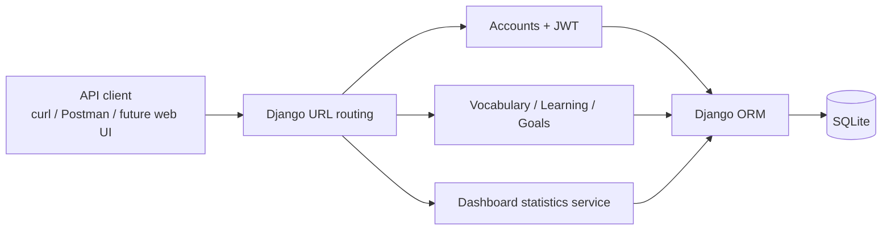

# Learning English Tracker

> **Track your learning. Build consistency. Make your English progress visible.**

[](https://github.com/Q1Patrick/Learning-English-Tracker/actions/workflows/django.yml)


**Learning English Tracker** is an in-development web application for independent English learners. It provides a backend for managing vocabulary, recording study sessions, setting daily goals, and monitoring progress. The project is designed to grow into a complete learning experience with a polished web interface and AI-assisted writing feedback.

**Current state:** The repository's `main` branch contains the Django REST API and data models described below. A learner-facing frontend, a working AI-feedback endpoint, and a production deployment have **not** been verified as implemented on `main`.

---

## Contents

- [Why this project?](#why-this-project)
- [Features and project status](#features-and-project-status)
- [Technology stack](#technology-stack)
- [System architecture](#system-architecture)
- [Project structure](#project-structure)
- [Getting started](#getting-started)
- [API reference](#api-reference)
- [Example API workflow](#example-api-workflow)
- [Testing and continuous integration](#testing-and-continuous-integration)
- [Security and deployment readiness](#security-and-deployment-readiness)
- [Roadmap](#roadmap)
- [Contributing](#contributing)
- [Project documentation](#project-documentation)
- [License](#license)

## Why this project?

Learning a language takes consistency, but learners often struggle to measure what they have studied and what needs more attention. Learning English Tracker aims to make that process easier by helping users:

- Organize vocabulary and track familiarity with each word.
- Log speaking, listening, reading, writing, vocabulary, and grammar practice.
- Set a study-time target for a specific day.
- See daily and weekly activity summaries.
- Eventually receive explanations and corrections for English writing.

The primary audience is students and self-directed English learners. The application uses CEFR levels **A1–C2** in its user-profile model.

## Features and project status

Status labels distinguish **code present in the repository** from **functionality verified in a running application**.

| Feature | Status on `main` | Relevant implementation |
| --- | --- | --- |
| Email registration and JWT login | Implemented in code; runtime verification pending | `apps/accounts/` |
| JWT refresh and verification | Implemented in code; runtime verification pending | `apps/accounts/urls.py` |
| User profile and CEFR level | Implemented in code; runtime verification pending | `apps/accounts/` |
| Vocabulary CRUD and mastery tracking | Implemented in code; runtime verification pending | `apps/vocabulary/` |
| Study-session tracking | Implemented in code; runtime verification pending | `apps/learning/` |
| Daily study goals | Implemented in code; runtime verification pending | `apps/goals/` |
| Daily/weekly dashboard statistics | Implemented in code; runtime verification pending | `apps/statistic/` |
| API health check | Implemented in code; runtime verification pending | `apps/learning/` |
| Learner-facing web UI | Planned; no implementation found in the audited `main` tree | — |
| AI writing feedback | Planned; existing files are scaffolding, with no registered API route | `apps/ai_feedback/` |
| Quiz and flashcards | Future scope; not part of the current API | — |

> **Verification note:** "Implemented in code" does not mean that all integration tests pass or that a feature has been deployed. Check your local branch, run the tests, and validate the API before marking a feature complete.

### Current domain behavior

- **Vocabulary:** A learner owns vocabulary entries with a word, meaning, optional translation and example, part of speech, notes, and a mastery state (`new`, `learning`, `familiar`, `mastered`). The model declares a uniqueness constraint on `(user, word)`.
- **Study sessions:** Each session records an activity type, duration (1–720 minutes), an optional score (0–100), notes, and study timestamp.
- **Daily goals:** A target of 5–480 minutes can be assigned to a date. The model declares one goal per user per date.
- **Dashboard:** Calculates today's target, minutes studied, minutes remaining, progress percentage (capped at 100%), session count, activity breakdown, and this week's minutes. The calculation respects the user's configured timezone and prioritizes a daily goal over the profile's default target.

## Technology stack

The following technologies are **present in the audited source code**, not merely suggested for future use.

| Layer | Technology |
| --- | --- |
| Language | Python |
| Backend | Django 4.2 |
| REST API | Django REST Framework 3.16 |
| Authentication | JWT via `djangorestframework-simplejwt` |
| Data access | Django ORM and migrations |
| Current database | SQLite |
| Automated checks | Django test runner and GitHub Actions |
| Development environment | Python virtual environment (`venv`) |

**Not yet an adopted stack on `main`:** React, TypeScript, Vite, Tailwind CSS, PostgreSQL, Docker, Redis, Celery, and any AI-provider SDK. These are potential future options, not documented requirements.

Dependency versions are maintained in [`requirements/base.txt`](requirements/base.txt).

## System architecture

The current backend uses a modular Django application structure.



The primary request lifecycle is:

1. An API client makes an HTTP request.
2. Django routes the request to an app-specific endpoint.
3. A DRF view authenticates the user and validates request data with a serializer.
4. Models or a service execute the relevant business logic using the Django ORM.
5. The API returns a JSON response.

Private resource endpoints use `IsAuthenticated` and filter querysets by the authenticated user. Keep this ownership rule when implementing new features.

## Project structure

```text
Learning-English-Tracker/
├── .github/
│   └── workflows/
│       └── django.yml           # Django CI workflow
├── apps/
│   ├── accounts/                # Custom user, profile, auth/JWT
│   ├── vocabulary/              # Vocabulary model and CRUD API
│   ├── learning/                # Study sessions and health check
│   ├── goals/                   # Daily-goal model and CRUD API
│   ├── statistic/               # Dashboard calculations and API
│   └── ai_feedback/             # Scaffold; AI API not implemented on main
├── common/                      # Shared modules; some are placeholders
├── config/
│   ├── settings/
│   │   ├── base.py
│   │   ├── development.py
│   │   └── production.py
│   ├── urls.py                  # Root URL routing
│   ├── asgi.py
│   └── wsgi.py
├── requirements/
│   ├── base.txt
│   ├── development.txt
│   └── production.txt
├── tests/                        # Test suite; coverage is incomplete
├── manage.py
└── README.md
```

> The module is named **`statistic`** (singular) in this repository. Do not rename it to `statistics` without an approved refactor and migration plan.

## Getting started

These steps describe **local development**, not a production deployment.

### Prerequisites

- Git
- Python 3.9–3.11 (the versions listed in the existing CI matrix; Python 3.11 is a reasonable local choice)
- `pip` and Python `venv`

### 1. Clone the repository

```bash
git clone https://github.com/Q1Patrick/Learning-English-Tracker.git
cd Learning-English-Tracker
```

The commands below use the repository's default `main` branch. If you are working on another branch, inspect its code and configuration before following the instructions.

### 2. Create and activate a virtual environment

**macOS / Linux:**

```bash
python3 -m venv venv
source venv/bin/activate
```

**Windows (PowerShell):**

```powershell
py -m venv venv
.\venv\Scripts\Activate.ps1
```

### 3. Install dependencies

```bash
python -m pip install --upgrade pip
python -m pip install -r requirements/development.txt
```

The development requirements include the packages from `requirements/base.txt`.

### 4. Apply database migrations

```bash
python manage.py migrate
```

The current base settings configure **SQLite**. With the repository's current `BASE_DIR` definition, the database is located under `config/db.sqlite3`.

> **Security notice:** The audited source contains a hardcoded Django `SECRET_KEY`. This is a known issue that must be remediated before production use. The current code does **not** automatically load a `.env` file, so creating `.env` alone does not fix this issue.

### 5. Start the development server

```bash
python manage.py runserver
```

The local API is available at:

```text
http://127.0.0.1:8000/
```

The project exposes **API routes**, not a completed website home page. A `404` at `/` does not necessarily mean the server failed. Use the health endpoint instead:

```bash
curl http://127.0.0.1:8000/api/v1/health/
```

Expected response shape:

```json
{
  "success": true,
  "status": "healthy",
  "message": "English Learning Tracker API is running."
}
```

### 6. Run checks and tests

```bash
python manage.py check
python manage.py test
```

A failing command should be investigated and reported; test success has not been asserted in this README.

## API reference

**Base URL:** `http://127.0.0.1:8000/api/v1/`

Endpoints below are defined in the audited `main` branch. For authenticated requests, send:

```http
Authorization: Bearer <ACCESS_TOKEN>
```

| Method | Endpoint | Access | Purpose |
| --- | --- | --- | --- |
| `GET` | `/health/` | Public | API health response |
| `POST` | `/auth/register/` | Public | Register a user |
| `POST` | `/auth/login/` | Public | Obtain JWT access and refresh tokens |
| `POST` | `/auth/token/refresh/` | Public, with refresh token in body | Refresh the access token |
| `POST` | `/auth/token/verify/` | Public, with token in body | Verify a JWT |
| `GET`, `PATCH`, `PUT` | `/auth/me/` | JWT | Read or update the current user/profile |
| `GET`, `POST` | `/vocabulary/` | JWT | List or create vocabulary entries |
| `GET`, `PUT`, `PATCH`, `DELETE` | `/vocabulary/<uuid>/` | JWT | Read/update/delete one vocabulary entry |
| `GET`, `POST` | `/study-sessions/` | JWT | List or create study sessions |
| `GET`, `PUT`, `PATCH`, `DELETE` | `/study-sessions/<uuid>/` | JWT | Read/update/delete one study session |
| `GET`, `POST` | `/goals/` | JWT | List or create daily goals |
| `GET`, `PUT`, `PATCH`, `DELETE` | `/goals/<uuid>/` | JWT | Read/update/delete one daily goal |
| `GET` | `/statistic/dashboard/` | JWT | Get daily/weekly learning statistics |

These are **route-level contracts read from source code**. Actual request/response behavior must still be verified with automated tests and local API checks.

**Not available on the audited `main` branch:** `/api/v1/ai-feedback/`. Do not integrate a frontend against that endpoint until the backend implementation and contract have been approved.

## Example API workflow

The following examples use `curl`. Run the local server first.

### Register a learner

```bash
curl -X POST http://127.0.0.1:8000/api/v1/auth/register/ \
  -H "Content-Type: application/json" \
  -d '{
    "email": "learner@example.com",
    "password": "ExamplePassword123!",
    "password_confirm": "ExamplePassword123!",
    "first_name": "English",
    "last_name": "Learner"
  }'
```

### Log in

```bash
curl -X POST http://127.0.0.1:8000/api/v1/auth/login/ \
  -H "Content-Type: application/json" \
  -d '{
    "email": "learner@example.com",
    "password": "ExamplePassword123!"
  }'
```

The JWT login endpoint is implemented using SimpleJWT and is expected to return `access` and `refresh` tokens. Copy the `access` token to use in authenticated requests. **Never commit real tokens or credentials.**

### Add a vocabulary item

Replace `<ACCESS_TOKEN>` with a token from login.

```bash
curl -X POST http://127.0.0.1:8000/api/v1/vocabulary/ \
  -H "Content-Type: application/json" \
  -H "Authorization: Bearer <ACCESS_TOKEN>" \
  -d '{
    "word": "consistency",
    "meaning": "the quality of doing something regularly",
    "translation": "tính nhất quán",
    "part_of_speech": "noun",
    "example_sentence": "Consistency is important when learning English.",
    "mastery_level": "new"
  }'
```

### Record a study session

```bash
curl -X POST http://127.0.0.1:8000/api/v1/study-sessions/ \
  -H "Content-Type: application/json" \
  -H "Authorization: Bearer <ACCESS_TOKEN>" \
  -d '{
    "activity_type": "speaking",
    "duration_minutes": 30,
    "notes": "Practised introducing myself in English."
  }'
```

### View dashboard statistics

```bash
curl http://127.0.0.1:8000/api/v1/statistic/dashboard/ \
  -H "Authorization: Bearer <ACCESS_TOKEN>"
```

The dashboard serializer exposes fields including `date`, `timezone`, `target_minutes`, `studied_minutes`, `remaining_minutes`, `progress_percent`, `sessions_count`, `week_minutes`, and `activity_breakdown`.

## Testing and continuous integration

Automated tests live in the root `tests/` directory and app-specific test modules.

Run the complete suite:

```bash
python manage.py test
```

Run Django's configuration checks:

```bash
python manage.py check
```

The repository's [GitHub Actions workflow](.github/workflows/django.yml) is configured to run the Django test suite on pushes to `main` and pull requests targeting `main`, using Python **3.9, 3.10, and 3.11**.

**Current limitation:** Several test modules are placeholders or empty. Existing test files and CI configuration do not guarantee full coverage or a passing build. Recommended coverage includes:

- Registration, login, refresh, and profile authorization.
- Validation and owner isolation for vocabulary, goals, and study sessions.
- Daily statistics calculations, timezone boundaries, and empty-data cases.
- Duplicate-record behavior and invalid inputs.
- Mocked AI-provider failures when AI feedback is implemented.
- Frontend integration and accessibility once a frontend exists.

## Security and deployment readiness

**This repository should be treated as a development project, not a production-ready application.**

Issues identified in the audited source include:

1. **Hardcoded Django secret:** `config/settings/base.py` contains a committed `SECRET_KEY`. It should be replaced with environment-based secret management and rotated before any production use; review Git history as appropriate.
2. **Tracked database backup:** `config/db.sqlite3.backup` is present in the repository tree. Review it for sensitive data before deciding how to remove it safely.
3. **Duplicate authentication definitions:** `CurrentUserView` is defined twice in `apps/accounts/views.py`, and `/auth/me/` is registered twice in `apps/accounts/urls.py`. Review and consolidate with tests.
4. **Incomplete production configuration:** `config/settings/production.py` contains a placeholder host, and `requirements/production.txt` is empty.
5. **Incomplete test coverage:** Some test files are empty or contain minimal placeholder tests.

Before any public deployment, also confirm HTTPS, secure environment variables, correct `ALLOWED_HOSTS`, database backups, CORS/CSRF policy as applicable, error monitoring, deployment health checks, and a rollback strategy.

Avoid adding production URLs, live credentials, API keys, or real user data to documentation and commits.

## Roadmap

The following items describe planned engineering work, **not completed features**.

| Priority | Milestone | Key deliverables |
| --- | --- | --- |
| P0 | Audit and security stabilization | Verify local branch/tests, rotate and externalize secrets, review tracked backup |
| P1 | Core API quality | Consolidate duplicate auth code, add focused tests, verify API contracts |
| P1 | UI/UX and frontend MVP | Responsive login, dashboard, vocabulary, study sessions, goals, profile |
| P2 | AI Writing Feedback | Approved API contract, provider abstraction, structured corrections, safe error handling, mocked tests |
| P1 | Integration and release QA | Regression tests, bug tracking, security review, documentation |
| P2 | Future learning enhancements | Quiz/flashcards and additional learning tools once the core product is stable |

For AI feedback, the proposed flow is **authenticated client → Django endpoint → AI service adapter → AI provider → structured response**. A provider, SDK, billing model, and data-retention policy must be selected and approved before implementation.

## Contributing

Contributions and improvements should be small, reviewable, and supported by tests.

1. Check the project's current tasks and confirm the appropriate integration branch.
2. Create a branch using a descriptive prefix such as `feature/`, `fix/`, `test/`, or `docs/`.
3. Make focused changes that preserve existing APIs unless a change is explicitly approved.
4. Add or update relevant tests and run `python manage.py test` where feasible.
5. Review your own diff and open a pull request with a summary, test evidence, and any risks.

Example branch and commit message:

```bash
git switch -c docs/improve-readme
git add README.md
git commit -m "docs: improve project README"
```

Do not push directly to `main` or merge without the project owner's review. Inspect the current `develop` branch before using it as an integration target; it may not match `main`.

Suggested pull-request description:

```markdown
## Summary
- What changed and why

## Verification
- [ ] `python manage.py check`
- [ ] `python manage.py test`
- [ ] Manual verification (if applicable)

## Risks / Notes
- Known limitations and follow-up tasks
```

## Project documentation

The project may also maintain the following documents at the repository root as they are reviewed and added:

- `PRD.md` — Product requirements and scope.
- `ARCHITECTURE.md` — Existing system structure and design decisions.
- `DESIGN.md` — Proposed UI/UX guidelines.
- `RULES.md` — Engineering and AI-agent working rules.
- `TASKS.md` — Milestones, task owners, and acceptance criteria.
- `PROGRESS.md` — Verified progress and issues.
- `AGENTS.md` — Repository-specific AI-agent instructions.

These documents are **not confirmed to exist on the audited GitHub `main` branch**. Do not treat proposed designs or task statuses as evidence that code has been implemented.

## License

A license file was not found in the audited `main` branch. **Public visibility does not grant an open-source license.** The project owner should add an appropriate `LICENSE` file if redistribution or third-party reuse is intended.

---

**Maintained by:** [Q1Patrick](https://github.com/Q1Patrick)<br>
**Repository:** https://github.com/Q1Patrick/Learning-English-Tracker<br>
**Documentation audit:** `main` at commit [`f88ef78`](https://github.com/Q1Patrick/Learning-English-Tracker/commit/f88ef78d58e2890cbc695e102c3a805af81b1cbe) (2026-08-16). Local or unpushed changes may differ.
