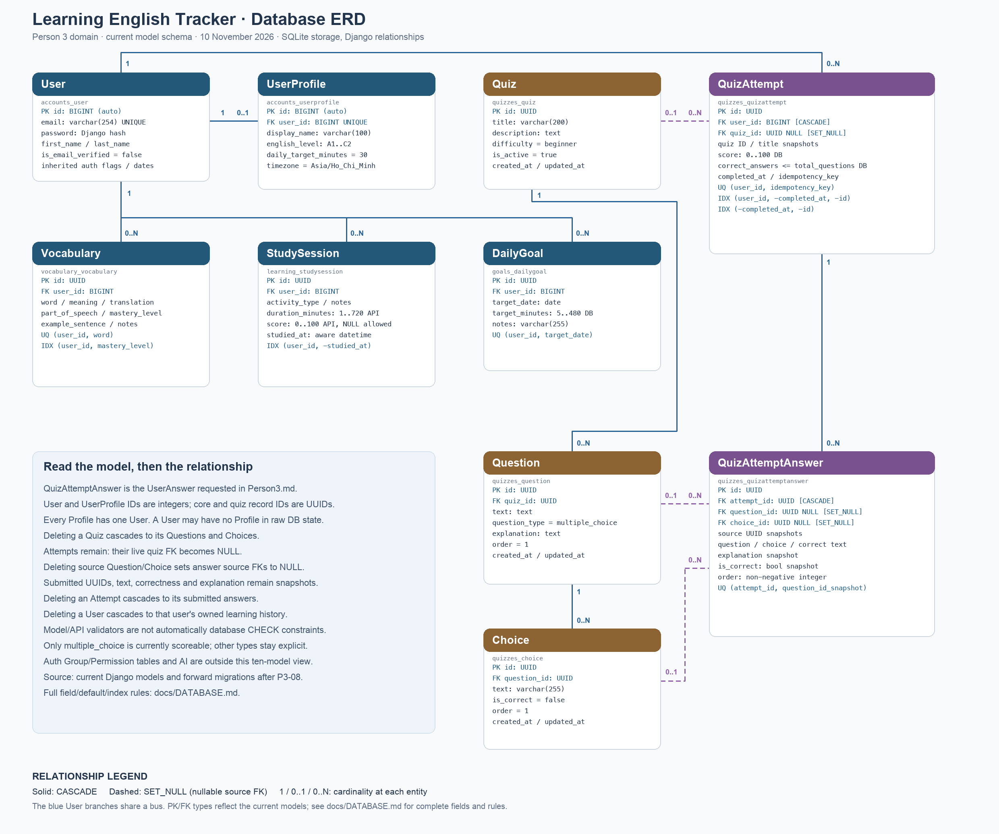

# Database — Learning English Tracker

Tài liệu P3-24, đối chiếu mã nguồn ngày 10/11/2026. Phạm vi chính gồm 10 model của Person3; `QuizAttemptAnswer` là phần triển khai tương đương tên `UserAnswer` trong yêu cầu. Không tạo model `UserAnswer` thứ hai.

Nguồn sơ đồ có thể sửa: [erd.json](database/erd.json). Bản vector: [erd.svg](database/erd.svg). Cách tái tạo: [hướng dẫn renderer](database/README.md). Sơ đồ là phần tóm tắt quan hệ; các bảng dưới đây mô tả đầy đủ các trường của model.

## Quy ước và nguồn sự thật

- Database ứng dụng hiện là SQLite; không coi PostgreSQL là thành phần đã tích hợp. Tên kiểu trong tài liệu là kiểu Django/logical: `UUIDField` được SQLite lưu dưới dạng chuỗi hex, còn PK `BigAutoField` dùng integer tự tăng.
- PK/FK trong HTTP có thể được serializer biểu diễn thành string. `User.id` và `UserProfile.id` vẫn là integer; không suy ra chúng là UUID chỉ vì response có string.
- Trường không ghi `NULL` là `null=False`. `blank=True` cho phép rỗng khi validation; nó không đồng nghĩa cột cho phép SQL NULL. Chuỗi rỗng và NULL là hai giá trị khác nhau.
- “Mặc định” dưới đây là default của Django/ORM, không phải lời khẳng định có SQL `DEFAULT`. `—` nghĩa là không có default khai báo rõ trên field. `uuid4` tạo UUID mới; auto PK do database cấp.
- `created_at` dùng `auto_now_add`, `updated_at` dùng `auto_now`, trừ khi ghi khác. Đây là hành vi Django; `QuerySet.update()` phải cập nhật timestamp rõ ràng nếu cần.
- `choices`, `MinValueValidator`, `MaxValueValidator`, kiểm tra serializer và service **không tự biến thành CHECK của database**, và `.save()` không tự chạy `.full_clean()`.
- FK/OneToOne tạo index phục vụ quan hệ; PK/UNIQUE có cơ chế index theo backend. Không thêm index user/quiz trùng chỉ vì không thấy tên index trong `Meta.indexes`.

## 1. User — `accounts_user`

Mục đích: danh tính và quyền xác thực. Nguồn: [accounts/models.py](../apps/accounts/models.py), kế thừa `AbstractUser`; manager chuẩn hóa email và hash mật khẩu.

| Trường | Kiểu / rỗng | Mặc định / vai trò |
|---|---|---|
| `id` | BigAutoField, PK | Integer tự tăng |
| `email` | EmailField(254), UNIQUE | —; `USERNAME_FIELD` |
| `password` | CharField(128) | —; hash Django, không lưu mật khẩu gốc |
| `first_name`, `last_name` | CharField(150), blank | —; thường lưu chuỗi rỗng |
| `last_login` | DateTime, NULL/blank | — |
| `date_joined` | DateTime | `timezone.now` |
| `is_active` | Boolean | `True` |
| `is_staff`, `is_superuser` | Boolean | `False` |
| `is_email_verified` | Boolean | `False` |

`username` đã bị loại khỏi model. Hai quan hệ M2M kế thừa `groups` và `user_permissions` trỏ tới auth Group/Permission; các bảng auth trung gian nằm ngoài ERD 10 model này.

Database bảo vệ email UNIQUE và PK. API kiểm tra định dạng, trim/lowercase, duplicate không phân biệt hoa/thường, mật khẩu mạnh và password confirmation. UNIQUE email trong SQLite không tự cung cấp toàn bộ quy tắc chuẩn hóa của ứng dụng. `email` có `db_index=True`; backend có thể dùng UNIQUE index cho tra cứu.

User có tối đa một Profile và có nhiều Vocabulary/StudySession/DailyGoal/QuizAttempt. Xóa User qua Django cascade các bản ghi sở hữu. Đây là hành vi xóa dữ liệu cá nhân có tác động lớn, không phải thao tác dùng để dọn đề mẫu.

## 2. UserProfile — `accounts_userprofile`

Mục đích: thông tin học tập và múi giờ của một User.

| Trường | Kiểu / rỗng | Mặc định / vai trò |
|---|---|---|
| `id` | BigAutoField, PK | Integer tự tăng |
| `user_id` | OneToOne → User.id (integer), UNIQUE | CASCADE |
| `display_name` | CharField(100), blank | — |
| `english_level` | CharField(2), choices A1–C2 | `A1` |
| `daily_target_minutes` | PositiveInteger | `30` |
| `learning_goal` | Text, blank | — |
| `timezone` | CharField(64) | `Asia/Ho_Chi_Minh` |
| `created_at`, `updated_at` | DateTime | Auto insert / auto save |

OneToOne bảo vệ một profile/user và có UNIQUE index. Một Profile luôn phải có User; database không buộc mọi User phải có Profile. Luồng đăng ký tạo cả hai trong transaction, còn service thống kê có fallback nếu profile chưa tồn tại.

API kiểm tra `daily_target_minutes` từ 5–480 và tên múi giờ IANA hợp lệ. Hiện không có named DB CHECK cho giới hạn 5–480 hoặc múi giờ; PositiveInteger bảo vệ miền số không âm theo backend. Email và trạng thái xác minh chỉ đọc trong endpoint hồ sơ. User và Profile được cập nhật cùng transaction.

## 3. Vocabulary — `vocabulary_vocabulary`

Mục đích: sổ từ vựng riêng của một User.

| Trường | Kiểu / rỗng | Mặc định / vai trò |
|---|---|---|
| `id` | UUID, PK | `uuid4` |
| `user_id` | FK → User.id (integer) | CASCADE; auto FK index |
| `word` | CharField(150) | — |
| `meaning` | Text | — |
| `translation` | CharField(255), blank | — |
| `part_of_speech` | CharField(20), choices | `other` |
| `example_sentence`, `notes` | Text, blank | — |
| `mastery_level` | CharField(20), choices | `new` |
| `created_at`, `updated_at` | DateTime | Auto insert / auto save |

DB UNIQUE `unique_vocabulary_word_per_user` trên `(user, word)`. Index `vocab_user_mastery_idx` trên `(user, mastery_level)` phục vụ danh sách theo mức thành thạo.

Các lựa chọn từ loại: noun, verb, adjective, adverb, phrase, phrasal_verb, other. Mastery: new, learning, familiar, mastered. Đây là model/API choices, không phải CHECK enum ở database. API trim từ, từ chối từ rỗng và trả lỗi duplicate theo user; không tự lower-case toàn bộ từ. Vì vậy không khẳng định UNIQUE này gộp mọi biến thể hoa/thường. Service/queryset luôn giới hạn dữ liệu bằng user đang đăng nhập.

## 4. StudySession — `learning_studysession`

Mục đích: ghi nhận một hoạt động học.

| Trường | Kiểu / rỗng | Mặc định / vai trò |
|---|---|---|
| `id` | UUID, PK | `uuid4` |
| `user_id` | FK → User.id (integer) | CASCADE; auto FK index |
| `activity_type` | CharField(20), choices | — |
| `duration_minutes` | PositiveSmallInteger | —; model/API 1–720 |
| `score` | PositiveSmallInteger, NULL/blank | —; model/API 0–100 |
| `notes` | Text, blank | — |
| `studied_at` | DateTime | `timezone.now` |
| `created_at`, `updated_at` | DateTime | Auto insert / auto save |

Hoạt động: speaking, listening, reading, writing, vocabulary, grammar. Ordering mặc định `-studied_at`. Index `study_user_studied_idx` trên `(user, -studied_at)` hỗ trợ bộ lọc user và khoảng thời gian; FK user cũng có index mặc định.

Giới hạn duration/score nằm ở validators và serializer; hiện không có named DB CHECK tương ứng cho duration 1–720 hoặc score ≤100. PositiveSmallInteger không thay thế toàn bộ các giới hạn đó khi ghi trực tiếp bằng ORM/SQL. Thống kê và bộ lọc ngày diễn giải thời điểm theo timezone của UserProfile, với timestamp aware/UTC khi lưu qua Django.

## 5. DailyGoal — `goals_dailygoal`

Mục đích: mục tiêu phút học của một User cho một ngày lịch.

| Trường | Kiểu / rỗng | Mặc định / vai trò |
|---|---|---|
| `id` | UUID, PK | `uuid4` |
| `user_id` | FK → User.id (integer) | CASCADE; auto FK index |
| `target_date` | Date | — |
| `target_minutes` | PositiveSmallInteger | —; 5–480 |
| `notes` | CharField(255), blank | — |
| `created_at`, `updated_at` | DateTime | Auto insert / auto save |

DB UNIQUE `unique_daily_goal_per_user_date` trên `(user, target_date)`; DB CHECK `daily_goal_target_between_5_and_480` bảo vệ range. UNIQUE index cũng hỗ trợ truy vấn mục tiêu đúng ngày của một user. Ordering `-target_date`.

Serializer kiểm tra trùng sớm, bỏ qua chính record khi update; constraint tiếp tục bảo vệ request đồng thời. Chỉ lỗi đúng constraint được chuyển thành validation error sau khi rollback savepoint; lỗi database khác vẫn được ghi nhận theo nguyên nhân thật.

## 6. Quiz — `quizzes_quiz`

Mục đích: đề dùng chung, không thuộc riêng một User.

| Trường | Kiểu / rỗng | Mặc định / vai trò |
|---|---|---|
| `id` | UUID, PK | `uuid4` |
| `title` | CharField(200) | —; required khi model/admin validation; API hiện chỉ đọc đề |
| `description` | Text, blank | — |
| `difficulty` | CharField(20), choices | `beginner` |
| `is_active` | Boolean | `True` |
| `created_at`, `updated_at` | DateTime | Auto insert / auto save |

Difficulty: beginner/intermediate/advanced. Ordering `-created_at`; public list thêm `-id` làm tie-breaker. Không có UNIQUE title hoặc custom index khác PK. Chỉ đề active được lấy/nộp qua public API.

`blank=False` và CharField không tự bảo đảm mọi câu lệnh ORM/SQL đều từ chối chuỗi rỗng; không có DB CHECK `title != ''`. Seed/admin/full_clean và test dùng validation của Django.

## 7. Question — `quizzes_question`

Mục đích: câu hỏi thuộc một đề.

| Trường | Kiểu / rỗng | Mặc định / vai trò |
|---|---|---|
| `id` | UUID, PK | `uuid4` |
| `quiz_id` | FK → Quiz.id (UUID) | CASCADE; auto FK index |
| `text` | Text | — |
| `question_type` | CharField(30), choices | `multiple_choice` |
| `explanation` | Text, blank | — |
| `order` | PositiveSmallInteger | `1` |
| `created_at`, `updated_at` | DateTime | Auto insert / auto save |

Choices cho type: multiple_choice/vocabulary/grammar/translation; hiện chỉ multiple_choice được service chấm điểm. Một đề có thể chưa có câu, nhưng đề rỗng không được submit. Không có UNIQUE `(quiz, order)`; thứ tự trùng được xử lý bằng ordering/tie-breaker ở truy vấn. Model ordering `(order, created_at)`; API dùng `(order, id)` cho thứ tự ổn định của đề.

Xóa Quiz cascade Question. Các QuizAttemptAnswer tham chiếu câu bị xóa được SET_NULL ở FK nguồn; snapshot vẫn giữ nguyên.

## 8. Choice — `quizzes_choice`

Mục đích: một lựa chọn thuộc một câu hỏi.

| Trường | Kiểu / rỗng | Mặc định / vai trò |
|---|---|---|
| `id` | UUID, PK | `uuid4` |
| `question_id` | FK → Question.id (UUID) | CASCADE; auto FK index |
| `text` | CharField(255) | — |
| `is_correct` | Boolean | `False` |
| `order` | PositiveSmallInteger | `1` |
| `created_at`, `updated_at` | DateTime | Auto insert / auto save |

Ordering `(order, created_at)`; API dùng `(order, id)`. Không có custom index/UNIQUE cho text hoặc order. “Ít nhất hai choices, đúng một choice correct cho multiple_choice” được kiểm tra trong Question admin inline, seed và submit service; không phải constraint DB đếm liên bảng. Giữ Choice inline tránh tạo màn sửa riêng mà bỏ qua validation toàn bộ câu.

Xóa Question cascade Choice; câu trả lời cũ giữ snapshot và nhận NULL ở FK nguồn tương ứng.

## 9. QuizAttempt — `quizzes_quizattempt`

Mục đích: một lượt nộp bài đã được backend chấm. Mỗi lần làm lại có chủ đích là một row mới; replay idempotency không tạo lượt mới.

| Trường | Kiểu / rỗng | Mặc định / vai trò |
|---|---|---|
| `id` | UUID, PK | `uuid4` |
| `user_id` | FK → User.id (integer) | CASCADE; auto FK index |
| `quiz_id` | FK → Quiz.id (UUID), NULL/blank | SET_NULL; auto FK index |
| `quiz_id_snapshot` | UUID, NULL | Bản sao ID đề, không phải FK |
| `quiz_title_snapshot` | CharField(200) | Bản sao title; service/migration điền |
| `idempotency_key` | UUID, NULL/blank | Client có thể gửi UUID |
| `request_fingerprint` | CharField(64), blank | Hash payload chuẩn hóa, service điền |
| `score` | PositiveSmallInteger | —; 0–100 |
| `correct_answers`, `total_questions` | PositiveSmallInteger | `0` |
| `completed_at` | DateTime | Auto insert |

Ordering `(-completed_at, -id)`. DB CHECK `quiz_attempt_score_0_100`; CHECK `quiz_attempt_correct_lte_total`; UNIQUE `quiz_attempt_user_idem_unique` trên `(user, idempotency_key)`. NULL key cho phép các lượt độc lập. Không đặt UNIQUE `(user, quiz)` vì có làm lại đề.

Custom indexes:

- `quiz_user_completed_idx`: `(user, -completed_at, -id)` cho lịch sử riêng và khoảng thời gian.
- `quiz_completed_idx`: `(-completed_at, -id)` cho truy vấn thời gian toàn cục/admin.

Các snapshot không có tính chất referential integrity của FK; chúng được service chép trong cùng transaction với kết quả/answers. Backend kiểm tra câu thuộc đề, choice thuộc câu, đầy đủ/mỗi câu một lần và tự tính điểm; không tin điểm client gửi. Phân tích kế hoạch truy vấn: [INDEX_REVIEW.md](INDEX_REVIEW.md). Index không phải bằng chứng tự động về tốc độ production.

Xóa đề giữ Attempt và chuyển `quiz_id` thành NULL; không lọc các lượt đó khỏi lịch sử/thống kê chỉ vì đề nguồn mất. Xóa User cascade lịch sử của User. `completed_at` là thời điểm hoàn tất, không phải thời lượng làm bài.

## 10. QuizAttemptAnswer — `quizzes_quizattemptanswer`

Mục đích: đáp án đã nộp và snapshot lịch sử, tương đương UserAnswer trong Person3.

| Trường | Kiểu / rỗng | Mặc định / vai trò |
|---|---|---|
| `id` | UUID, PK | `uuid4` |
| `attempt_id` | FK → QuizAttempt.id (UUID) | CASCADE; auto FK index |
| `question_id` | FK → Question.id (UUID), NULL/blank | SET_NULL; auto FK index |
| `choice_id` | FK → Choice.id (UUID), NULL/blank | SET_NULL; auto FK index |
| `question_id_snapshot` | UUID | —; ID nguồn tại lúc nộp |
| `choice_id_snapshot` | UUID | —; lựa chọn đã nộp |
| `correct_choice_id_snapshot` | UUID | —; lựa chọn đúng tại lúc nộp |
| `question_text`, `choice_text`, `correct_choice_text` | Text | —; nội dung tại lúc nộp |
| `explanation` | Text, blank | —; giải thích tại lúc nộp |
| `is_correct` | Boolean | —; kết quả chấm tại lúc nộp |
| `order` | PositiveSmallInteger | —; thứ tự lịch sử |

DB UNIQUE `quiz_answer_attempt_question_unique` trên `(attempt, question_id_snapshot)`; ordering `(order, id)`. FK database bảo vệ đối tượng tham chiếu tồn tại khi không NULL; service chịu trách nhiệm kiểm tra choice thuộc đúng question và question thuộc quiz. Model không có timestamp từng câu; thời điểm hoàn tất lấy từ Attempt.

Public API không cho sửa answer snapshot; admin hiển thị readonly cùng Attempt. Sửa/xóa nội dung đề sau đó không ghi đè text/correctness/score lịch sử. Đây là hợp đồng của ứng dụng; không khẳng định mọi câu lệnh SQL trực tiếp đều không thể cập nhật snapshot.

## Migration, lịch sử và thống kê

Nguồn schema là model cùng forward migrations; sự hiện diện file không chứng minh database đang dùng đã áp dụng chúng. Quiz `0005_attempt_answer_history_and_constraints` kiểm tra legacy attempts sai trước khi thêm constraint, bổ sung snapshot và answer table. Legacy attempts giữ score/quiz metadata đã có; `answers=[]` vì không thể bịa lựa chọn chưa từng lưu. Các index mới được khai báo qua `quizzes/0006_history_query_indexes.py` và `learning/0002_history_query_indexes.py`.

Kiểm chứng trên DB tạm/bản sao trước; kiểm tra database thật sau backup là một bước vận hành riêng cần phê duyệt. Không tự sửa/xóa row legacy không hợp lệ. Quy tắc xử lý dữ liệu sai và rollback phải được quyết định trước khi migrate dữ liệu đang dùng.

Thống kê quiz đã chốt theo tất cả completed attempts, gồm các lượt làm lại; Avg(score) là trung bình điểm từng lượt, không phải accuracy có trọng số theo số câu. Trend là 30 ngày lịch local của user. Dữ liệu không có bài dùng count0 và average NULL để phân biệt một bài thật có điểm0. Ghi chú này mô tả quyết định hợp đồng; xem API/tests hiện tại để xác nhận phần triển khai và tên field trả về.

## Phụ lục: AIFeedback ngoài 10 model Person3

`ai_feedback_aifeedback` có PK UUID, FK `user_id` integer CASCADE, `original_text`, `corrected_text`, `overall_feedback`, ba score nullable (`grammar_score`, `vocabulary_score`, `clarity_score`), JSON `mistakes`/`suggestions` mặc định list mới, `status` mặc định pending, `model_name`, `error_message`, `error_code`, `idempotency_key` UUID nullable, `request_fingerprint`, created/updated timestamps.

DB UNIQUE `unique_ai_feedback_user_key` trên `(user, idempotency_key)` và auto FK index. Score 0–100 được schema provider Pydantic bảo vệ; model hiện không có named DB CHECK cho cả ba score. Trạng thái pending/completed/failed và chuyển trạng thái được service quản lý, không phải database enum. Lỗi provider lưu thông điệp an toàn; không lưu khóa API trong row.

Model này nằm ngoài ERD chính để giữ hình đúng 10 entity Person3. Không suy ra lời gọi AI thật đã được nghiệm thu từ việc model hoặc mock tests có mặt.
